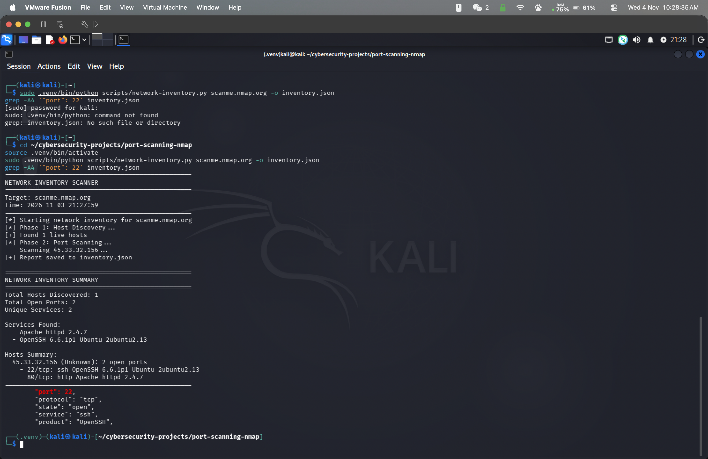
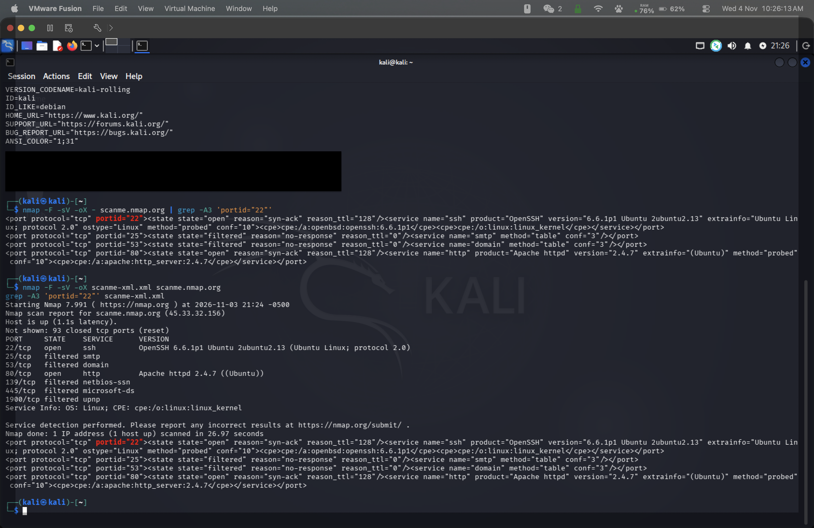

# Port Scanning with Nmap

A small network inventory tool built on Nmap and Python. It discovers live hosts, scans their services, and exports the results as JSON and CSV.

## Overview

This project is a small command-line inventory tool built on top of Nmap. It runs a host discovery scan, then a service and version scan on each live host, and prints a summary. Results can be saved as JSON and CSV for later analysis.

## Repository Contents

- `scripts/network-inventory.py`: discovers live hosts, scans open ports and services, prints a summary, and optionally exports JSON and CSV.
- `docs/`: screenshots and trimmed example output.
- `requirements.txt`: Python dependencies.

## Requirements

- Python 3.14.8 (tested)
- Nmap installed and available in `PATH` (tested with 7.991)
- Scan only networks you own or have written permission to test.

## Usage

```bash
pip install -r requirements.txt
python3 scripts/network-inventory.py 192.168.1.0/24 -o inventory.json -c inventory.csv
```

| Option           | Description                                    |
| ---------------- | ---------------------------------------------- |
| `target`         | Network or host to scan, e.g. `192.168.1.0/24` |
| `-o`, `--output` | Write the full inventory to a JSON file        |
| `-c`, `--csv`    | Export one row per port to a CSV file          |

## Example Output

Direct Nmap run:

```
nmap -F -sV scanme.nmap.org

Starting Nmap 7.991 (https://nmap.org) at 2026-11-03 09:20 -0500

Nmap scan report for scanme.nmap.org (45.33.32.156)

Host is up (0.41s latency).

Not shown: 93 closed tcp ports (reset)

PORT STATE SERVICE VERSION
22/tcp open ssh OpenSSH 6.6.1p1 Ubuntu 2ubuntu2.13 (Ubuntu Linux; protocol 2.0)
25/tcp filtered smtp
53/tcp filtered domain
80/tcp open http Apache httpd 2.4.7 ((Ubuntu))
139/tcp filtered netbios-ssn
445/tcp filtered microsoft-ds
1900/tcp filtered upnp
Service Info: OS: Linux; CPE: cpe:/o:linux: linux_kernel

Service detection performed. Please report any incorrect results at https://nmap.org/submit/

Nmap done: 1 IP address (1 host up) scanned in 21.34 seconds
```

Script output, first run (before fix)

```bash
sudo .venv/bin/python scripts/network-inventory.py scanme.nmap.org
--------------------------------------------------
NETWORK INVENTORY SCANNER
--------------------------------------------------
Target: scanme.nmap.org
Time: 2026-11-03 09:10:48
--------------------------------------------------
[*] Starting network inventory for scanme.nmap.org
[*] Phase 1: Host Discovery ...
[+] Found 1 live hosts
[*] Phase 2: Port Scanning ...
    Scanning 45.33.32.156...

--------------------------------------------------
NETWORK INVENTORY SUMMARY
--------------------------------------------------
Total Hosts Discovered: 1
Total Open Ports: 2
Unique Services: 2

Services Found:
- Apache httpd 2.4.7

Hosts Summary:
45.33.32.156 (Unknown): 2 open ports
- 22/tcp: tcpwrapped
- 80/tcp: http Apache httpd 2.4.7
--------------------------------------------------
```





## Lab Environment

- OS: Kali Linux GNU/Linux Rolling running in VMware Fusion
- Nmap version: 7.991
- Network scanned: scanme.nmap.org (public Nmap test host)

## Findings

Scanned `scanme.nmap.org` (45.33.32.156), a public test host provided by the Nmap project, from a Kali Linux VM.

| Port   | State | Service | Version                |
| ------ | ----- | ------- | ---------------------- |
| 22/tcp | open  | ssh     | OpenSSH 6.6.1p1 Ubuntu |
| 80/tcp | open  | http    | Apache httpd 2.4.7     |

Ports 25, 53, 139, 445, and 1900 were filtered and the remaining 93 ports were closed.

Comparing the script's output with a direct `nmap -F -sV` run:
- Port 80 matched exactly.
- Port 22 showed as `tcpwrapped` in the script but as `ssh` in the direct scan. The XML output from `nmap -oX` confirmed the service name, so the difference came from how the probe responded during that run.

## Known Issues

- Service detection can return `tcpwrapped` without a product name when the banner is not available.

## What I Learned

- Parsing Nmap output is harder than running it. The script's `Unique Services` count included an empty value from a port with no product name. The value was stored but never printed, so the count and the list disagreed. I found this by comparing the summary against the stored data. The fix only stores services that have a product name. I checked the filter logic with an empty product value. The live target always returned a product name for port 22, so the full script was not tested against a host without one.
- The same host can return different results between scans. Service detection depends on probe timing and responses, so a single scan is not a complete picture. Comparing against a direct Nmap run and the XML output helped me verify the script's data.

## Limitations

- Service and version detection depends on Nmap's fingerprint database and can be wrong.
